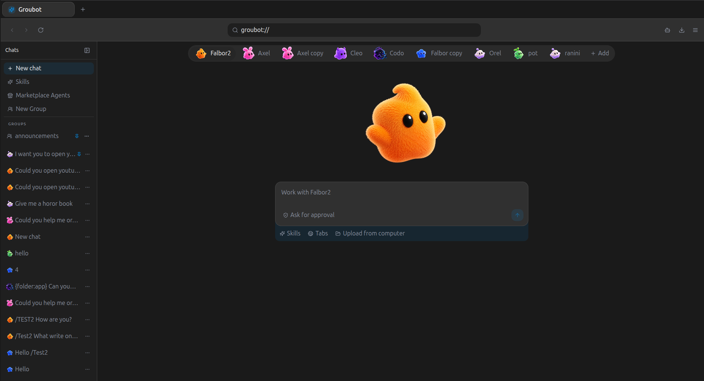

# Groubot



Groubot is an open-source, AI-native browser where customizable agents work directly inside your browsing sessions—researching, organizing, and completing tasks while you stay in control.
Create a personal team of specialized agents, watch their work in real time, assign permissions, and let multiple agents collaborate across the same browser workspace.

## Why Groubot?

| Standard browser | Groubot |
| --- | --- |
| You browse and manage every task yourself. | Agents can work alongside you in the same browser. |
| One general browsing experience. | Specialized, customizable agents with distinct instructions and personalities. |
| Automation is usually separate from the browser. | Agent activity, tabs, permissions, and conversations share one workspace. |
| No built-in local agent memory or team structure. | Local persistence for agents, chats, skills, and collaborative agent groups. |

## Current status

Groubot is an actively developed early-stage project. The browser shell, local React interface, agent management, chat workspace, skills, marketplace, groups, SQLite persistence, and native CEF runtime are under active development. Website compatibility and provider-specific authentication can vary by platform.

## Requirements

The application architecture is designed to be cross-platform: the React interface, backend services, AI layer, and SQLite data layer are portable across Linux, macOS, and Windows. The currently checked-in native CEF host is Linux-first and uses X11, so Linux is the supported development runtime today; native macOS and Windows host builds still need to be added before claiming full cross-platform support.

For the current runtime, you need:

- Linux with a working graphical desktop session
- Node.js 22 or newer
- pnpm 10 or newer
- An OpenAI API key with available account credits
- CMake and a C++ toolchain for building the native CEF host when the host is not already available

## Installation

Clone the repository:

```bash
git clone https://github.com/orelrevivo/agents-browser.git
cd agents-browser
```

Install dependencies:

```bash
pnpm install
```

Create your local environment file:

```bash
cp .env.example .env
```

Open `.env` and add your API key:

```dotenv
OPENAI_API_KEY=your_api_key_here
OPENAI_MODEL=gpt-5.6-luna
```

Create an API key from the [OpenAI API keys page](https://platform.openai.com/api-keys), and make sure the account has billing or credits enabled. A small initial budget is sufficient for testing, but usage depends on the model and your conversations.

Never put a real key in `.env.example`, commit it to Git, or share it in screenshots or logs. The `.env` file is ignored by Git and is loaded by the local backend/runtime.

Start Groubot:

```bash
pnpm dev
```

The first native CEF startup may download or build the local CEF host. Later launches reuse the project-local runtime stored under `.groubot/`.

## Data and privacy

Groubot uses SQLite for local application data, so no Docker container or separate database server is required. Agents, conversations, skills, and related configuration are stored locally on your machine. Website content is only sent to an AI provider when an agent execution or tool requires it.

Review your agent permissions before allowing browser actions. Do not give an agent access to sensitive websites or information unless you understand what it can do.

## Development

Useful commands:

```bash
pnpm dev                 # Start the desktop application
pnpm typecheck           # Check workspace TypeScript packages
pnpm --filter @groubot/desktop build
```

The project is organized as a pnpm workspace. Shared UI primitives belong in `packages/ui`; database code lives in `packages/db`; AI and agent services live in `packages/ai` and `packages/backend`; the desktop renderer and native browser integration live under `apps/desktop` and `packages/browser`.

## Roadmap

- More model providers and local-model support
- Richer agent skills and collaborative workflows
- Stronger browser compatibility and permission controls
- Cross-platform native packaging
- A public landing page and broader community tooling

## Contributing

Issues, ideas, and pull requests are welcome. Before contributing, read `AGENTS.md`, keep changes modular, reuse the shared design system, and avoid committing secrets, local databases, build output, or generated runtime files.

## License

See the repository license file for the current licensing terms.
